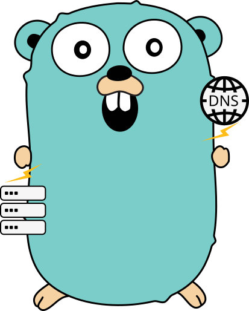

<p align="center">
  
</p>

<h1 align="center">aac-ddns-updater</h1>

<p align="center">Self-hosted deployment definition for DDNS Updater, a lightweight program that keeps DNS records pointed at your current public IP.</p>

<p align="center">
  <a href="https://github.com/qdm12/ddns-updater"></a>
  
  <a href="https://github.com/qdm12/ddns-updater/blob/master/LICENSE"></a>
</p>

## About

DDNS Updater periodically checks the public IP address of the host it runs on and updates
the matching dynamic DNS record at a DNS provider when the address changes. It is a small,
single-container service that supports many DNS providers and both IPv4 and IPv6.

Key features (as provided by upstream):

- Updates dynamic DNS records at a wide range of DNS providers
- IPv4 and IPv6 support, including a configurable IPv6 suffix
- Several public IP fetchers, with configurable selection
- Configurable update period and cooldown between updates
- Small footprint and non-root operation (configurable UID/GID)

## Upstream

- Project: <https://github.com/qdm12/ddns-updater>
- Container image: `ghcr.io/qdm12/ddns-updater:v2.10.0`
- License: MIT (upstream project)

## Quick start (Docker Compose)

The Compose file is rendered from `service.yml` by the App-as-Code template engine. For a
manual run, the external networks used for routing must exist first:

```bash
docker network create services-secured
docker network create services-exposed

# Provide the values listed under "Configuration" in .env / stack.env
docker compose up -d
```

Secrets are not stored in this repository. Provide them through the deployment pipeline
or create the `.env` and `stack.env` files yourself (see below). Do not commit them.

## Configuration

Environment variables (defaults from `service.yml`; `CHANGE_ME` must be set per deployment):

| Variable | Default | Description |
|---|---|---|
| `DDNS_PROVIDER` | `ionos` | DNS provider used for the update |
| `DDNS_DOMAIN` | `CHANGE_ME` (secret) | Domain of the DNS record to update |
| `DDNS_HOST` | `CHANGE_ME` (secret) | Host name within the domain (for example `@` or `www`) |
| `DDNS_API_KEY` | `CHANGE_ME` (secret) | API key or token for the DNS provider |
| `DDNS_IP_VERSION` | `ipv4` | IP version to update (`ipv4`, `ipv6` or `ipv4 or ipv6`) |
| `DDNS_IPV6_SUFFIX` | empty | IPv6 suffix appended to the detected prefix, if required |
| `LOG_LEVEL` | `info` | Log verbosity |
| `TZ` | `Europe/Berlin` | Time zone |
| `PUBLICIP_FETCHERS` | `all` | Public IP fetchers to use |
| `RESOLVER_ADDRESS` | `CHANGE_ME` | DNS resolver address used for lookups |
| `PERIOD` | `5m` | Interval between update checks |
| `UPDATE_COOLDOWN_PERIOD` | `5m` | Minimum time between two updates |
| `LISTENING_ADDRESS` | `:8000` | Address and port the web interface listens on inside the container |
| `PUID` / `PGID` | `1000` | User and group ID the container runs as |

Ports:

| Port | Protocol | Purpose |
|---|---|---|
| `8000` | TCP | Web interface (`web`), external port `8989` in `service.yml` |

Volumes:

| Mount | Description |
|---|---|
| `data` -> `/updater/data` | Persistent data of DDNS Updater |

## Deploy with App-as-Code

1. Edit `service.yml`. It is the single source of truth for image, ports, environment,
   volumes and per-stage overrides. Do not edit the rendered output.
2. Pushing to `main` (or a configured stage branch) runs the service pipeline, which renders
   the manifests with `aac-template-engine` and triggers the deployment.
3. Releases of this definition are published under <https://github.com/app-as-code/aac-ddns-updater>.

## Credits and license

DDNS Updater is developed by the upstream project and its contributors and licensed under
MIT. This repository only contains the deployment definition for it and is not a fork of the
application. The logo is taken from the dashboard-icons collection; see
[`assets/ICON_SOURCE.md`](assets/ICON_SOURCE.md) for icon sources and licenses.
